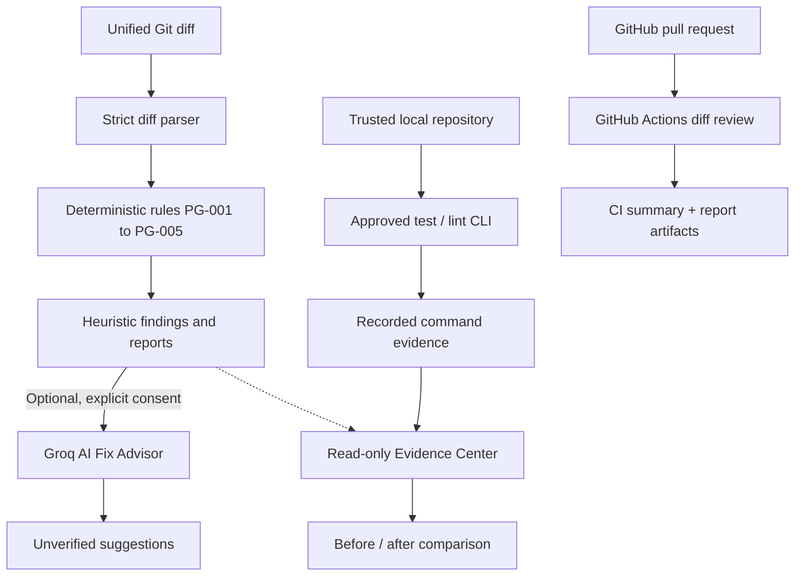

<div align="center">

# 🛡️ ProofGate

### AI can write the code. ProofGate helps you verify the change.

**Evidence-first review for AI-generated and human-written code.**  
Inspect Git diffs, understand potential regressions, run approved checks locally, and bring reproducible evidence into your pull-request workflow.

[**Try the live app**](https://proofgate-seven.vercel.app/) · [**Explore the code**](https://github.com/Kalpesh1Sharma/proofgate) · [**Report an issue**](https://github.com/Kalpesh1Sharma/proofgate/issues)


**Built with Alan AI and open models for OpenFire 2026.**

</div>

---

## Why ProofGate?

AI-assisted coding makes changing software easier. It doesn't make every change correct. A removed permission check, widened financial threshold, or missing regression test can hide inside an otherwise plausible diff.

**ProofGate turns a change into reviewable evidence, without pretending a pattern match is proof of a bug.** Its deterministic engine points to exact changed lines. The optional AI advisor explains a selected finding with explicit consent. A separate local CLI records the results of *real* test/lint commands, and the Evidence Center compares those results before and after a fix. A read-only GitHub Actions workflow brings diff review to pull requests.

> **Important distinction:** **HEURISTIC** means “worth investigating,” **AI SUGGESTION — NOT VERIFIED** means “model-generated advice,” and **PASSED / FAILED** refer only to commands that actually ran. None of these is a guarantee that code is secure.

## See it in action

**Live dashboard:** https://proofgate-seven.vercel.app/

The built-in loan-eligibility example demonstrates changes to validation, authorization, monetary boundaries, and rounding. The sample produces **10 heuristic findings (7 high, 3 low)** in the current demo; they are *potential risks*, not confirmed vulnerabilities.

| Review stage | What you see | What it establishes |
| --- | --- | --- |
| **01 · Detect** | Changed files, specific lines, rule IDs, severity, surrounding diff | Deterministic patterns that merit review |
| **02 · Explain** | Optional Groq-powered risk, correction, and test suggestions | Unverified guidance for a selected finding |
| **03 · Verify** | Local allowlisted tests/lint, actual exit codes, logs, times, commit | Recorded command outcomes for a trusted checkout |
| **04 · Compare** | Before/after reports with `FAILED → PASSED` where recorded | Traceable evidence that the specific command result changed |
| **05 · Integrate** | GitHub Actions job summary and report artifacts | Automatic *diff review* for pull requests; not a test run |

### Product tour in under a minute

1. Open the [live app](https://proofgate-seven.vercel.app/) and select **Load example** → **Analyse diff**.
2. In **Findings**, expand an authorization or financial-validation finding to see the original code evidence and a suggested test.
3. Optionally choose **Explain with AI**, inspect the consent details, then **Send to Groq**. This sends a bounded excerpt, **not** the entire repository.
4. Open **Report** to copy/download the Markdown or JSON analysis.
5. Open **Evidence** → **Load demo pair** to inspect recorded failure and success results, or import your own CLI-generated reports.

No account is needed for the deterministic dashboard.

## What ships in v0.5

### Diff review — explainable by design

- Accepts standard two-way unified Git diffs up to **200 KB**.
- Tracks files, hunks, additions/deletions, and old/new line numbers; rejects malformed, binary, combined, or oversized inputs rather than silently guessing.
- Runs five deterministic rules (PG-001 through PG-005) with evidence, severity, explanation, and a recommended test.
- Exports Markdown and JSON reports, including provenance and verification limitations.

### AI Fix Advisor — optional and consent-gated

- An **Explain with AI** action is available for each finding.
- Before any provider request, a consent panel specifies what will be sent: finding metadata, evidence, and at most 20 lines of surrounding diff context.
- Groq returns structured `likelyRisk`, `suggestedCorrection`, `recommendedTest`, and `limitations` fields; the server validates and bounds the response.
- Every response is explicitly labelled **AI SUGGESTION — NOT VERIFIED** and never changes the deterministic finding or a test outcome.
- Missing server credentials disable AI assistance without disabling the rest of ProofGate.

### Trusted-local verification — actual outcomes, not generated scores

- An explicit `--approve` flag is required before executing the fixed `test` and/or `lint` task IDs.
- Commands run only against a **trusted local Git checkout**, using argument arrays and `spawn` with `shell: false`.
- Reports record commit, exit code, timestamps, duration, bounded stdout/stderr, timeout/spawn errors, and skipped checks.
- **This CLI is not a sandbox:** `npm run test` can execute arbitrary repository scripts with your user permissions. Do not use it on untrusted repositories.

### Verification Evidence Center — readable proof

- Import size-limited JSON reports via file picker; the interface **never executes imported data** or fetches paths inside it.
- See `PASSED`, `FAILED`, `TIMED OUT`, and `NOT RUN` as separate states.
- Compare before/after runs side by side, including commit references and recorded command output.
- Try bundled **DEMO DATA**, generated from the reproducible local fixture rather than fictional test outcomes.

### GitHub Actions — review on every pull request

- The workflow in [`.github/workflows/proofgate.yml`](.github/workflows/proofgate.yml) computes a diff and runs the deterministic review CLI.
- Publishes a GitHub job summary and downloadable Markdown/JSON artifacts.
- Checks out **base-branch tooling**, fetches the PR head as diff data only, and does **not** execute PR code or call Groq.
- Uses `pull_request`, read-only `contents: read` permissions, and no application secrets.

**Real workflow validation:** [PR #1](https://github.com/Kalpesh1Sharma/proofgate/pull/1) exercised the GitHub Action. The run completed successfully and produced a review summary. Its documentation-only change produced a low-severity PG-005 heuristic finding; this illustrates that heuristics can produce false positives and should be reviewed critically.

---

## Quick start

**Requirements:** Node.js **20.9+**, npm; Git is required for the local verification CLI. Developed with Next.js 16 and TypeScript.

```bash
git clone https://github.com/Kalpesh1Sharma/proofgate.git
cd proofgate
npm install
npm run dev
```

Open **http://localhost:3000**. Then select **Load example** → **Analyse diff**.

Useful checks:

```bash
npm test          # automated Vitest suite
npm run lint      # ESLint
npm run typecheck # TypeScript, no emit
npm run build     # production build
```

The v0.5 release was independently exercised with **189 passing automated tests**, a clean lint run, and a successful production build. This is a release-time observation, not a live coverage or quality guarantee.

## Reproduce a real failure → pass

The quickest way to see *verification evidence* instead of a synthetic status is the local demo:

```bash
npm run verify:demo -- --keep
```

This creates a temporary Git fixture from [`examples/phase2-fix/`](examples/phase2-fix/), runs the allowlisted `test` task with the **failing** implementation, applies the corrected implementation, commits it, and runs the **same real command** again. It prints the workspace path, where you'll find:

```text
report-before-fix.json   # actual test FAILED (exit 1)
report-after-fix.json    # actual test PASSED (exit 0)
```

Open the dashboard's **Evidence** tab and import these files as **Before** and **After**. Or click **Load demo pair** to inspect the shipped, explicitly labelled **DEMO DATA** snapshots. The bundled snapshots preserve recorded outcomes; machine-specific absolute paths are redacted for publication.

### Run approved checks on your own *trusted* repository

```bash
npm run verify -- --repo <path> --ref HEAD --task test,lint --approve --out report.json
```

| Option | Meaning |
| --- | --- |
| `--repo <path>` | Existing trusted local Git work tree; required |
| `--ref <git-ref>` | Resolved branch/tag/SHA; defaults to `HEAD` |
| `--task <ids>` | `test`, `lint`, or both; defaults to `test` |
| `--approve` | Mandatory, explicit authorization to run tasks |
| `--diff <file>` | Optionally attach separate heuristic findings |
| `--out <file>` | Save JSON evidence locally |
| `--json` | Write JSON to standard output |

The task allowlist maps only `test` → `npm run test` and `lint` → `npm run lint`. You cannot supply arbitrary shell commands through these flags. **Running a trusted repository's npm scripts still executes code and can access the filesystem or network.**

## Use ProofGate in CI

The repository includes a pull-request workflow. Once that workflow and the CLI are on the base branch, new PRs trigger a deterministic review and upload report artifacts.

You can also run the CI analyzer without starting a server:

```bash
# Generate a normal text diff in your preferred shell.
git diff --no-ext-diff --output=pr.diff origin/main...HEAD
npm run ci:analyze -- --diff pr.diff --out-dir proofgate-report
```

**PowerShell tip:** Prefer Git's `--output=pr.diff` rather than redirecting `git diff > pr.diff`, since older PowerShell versions can write UTF-16 text containing NUL bytes.

CI generates:

```text
proofgate-report/
├── proofgate-report.md    # full heuristic review with provenance
├── proofgate-report.json  # structured review + CI metadata
└── proofgate-summary.md   # concise GitHub job summary
```

The optional `--fail-on none|high|medium|low` setting (default `none`) gates on *heuristic severity*, **not** application test failures. Successful CI analysis never means the PR was approved or proved safe. Diffs larger than 200 KB, unsupported formats, and binary patches require separate review.

> **Workflow trust boundary:** GitHub evaluates workflow definitions in its own PR context. Protect `.github/workflows/` with CODEOWNERS / branch rules and review workflow edits carefully. The provided workflow does not use `pull_request_target` and does not execute head-branch code.

## Optional Groq setup

The deterministic review, CI, local verification, and Evidence Center work **without** an API key.

For AI Fix Advisor, copy `.env.example` to `.env.local` and set the variables:

```dotenv
GROQ_API_KEY=your_private_groq_key
GROQ_MODEL=your_supported_model_id
```

Use a model ID your Groq account currently supports. The configured model ID is passed through without a silent fallback. Restart the development server after updating `.env.local`. For Vercel, configure both variables as **server-side** environment variables and redeploy; never use a `NEXT_PUBLIC_` prefix.

The optional advisor calls Groq's chat-completions API only **after per-finding consent**. The server imposes bounded input/output sizes, a 12-second timeout and best-effort rate limits (5 per client and 20 per instance per minute). **In-memory counters are not a global quota on serverless infrastructure**; public deployments should enforce an external shared or platform-level limit.

## How the pieces fit together



The tracks are intentionally separate: **text-pattern findings**, **AI advice**, and **executed command evidence** are different kinds of information.

### Detection rules

| Rule | Detects | Typical severity |
| --- | --- | --- |
| `PG-001` | Removed validation / rejection guard | Medium; high in money-related files |
| `PG-002` | Removed authorization, ownership, or role condition | High |
| `PG-003` | Removed money limit, financial comparison, or rounding | High |
| `PG-004` | Loosened numeric or comparison boundary | High |
| `PG-005` | Changed source without a corresponding test change | Low |

These are **bounded text heuristics**, not a semantic proof of a vulnerability. They may miss real issues or flag benign changes.

<details>
<summary><strong>Repository structure</strong></summary>

```text
src/
├── app/api/analyze/           deterministic diff analysis endpoint
├── app/api/ai/                consent-gated Groq suggestion + availability
├── components/ai/             finding-level AI consent and suggestion UI
├── components/evidence/       report importer, summaries, comparison
├── cli/verify.ts              allowlisted trusted-local verification
├── cli/ci.ts                  local unified diff → CI reports
└── lib/
    ├── engine/                parser, rules, types, limits
    ├── verification/          Git/ref checks, allowlist, runner, reports
    ├── evidence/              strict report validation and comparison
    ├── ai/                    server-only prompt, provider, validation
    ├── reports/               Markdown / JSON builders
    └── ci/                    summary and provenance
examples/phase2-fix/           reproducible before-and-after test fixture
scripts/                       demo and sample generation
tests/                         parser, rules, reports, verification, evidence, AI, CI
.github/workflows/proofgate.yml
```

</details>

## Security, privacy, and limitations

ProofGate is designed to make its **trust boundaries visible**:

| Component | Execution / data boundary |
| --- | --- |
| **Diff review** | The diff is parsed as untrusted text; it is never executed. In the hosted app, submitted text is processed by the app's server at `/api/analyze`, not solely on your device. |
| **AI advisor** | An explicitly approved excerpt is sent to Groq. Provider processing policies apply. AI suggestions are not verified findings. |
| **Evidence Center** | Imported JSON is validated and displayed locally in the browser; report paths are not resolved, executed, or fetched. |
| **Verification CLI** | Runs allowlisted npm scripts **locally** in a trusted Git work tree, with the operator's permissions. **Not sandboxed.** |
| **GitHub Actions** | Runs base-revision ProofGate code against diff data; does not run PR code or application tests. |

**What ProofGate does not promise:** complete security auditing, vulnerability confirmation, full code understanding from a diff, automated repairs, comprehensive test coverage, approval to merge, or proof that a codebase is safe. A passing test verifies only the executed task under the recorded conditions. A zero-finding review is not a security clearance.

Additional constraints: no authentication or database; the local verification runner supports npm projects; GitHub CI reviews text diffs up to 200 KB; the AI rate limiter is per instance; attached reports are limited and validated. Review the implementation and operate the CLI only on repositories you trust.

## Contributing

Contributions, focused bug reports, and reproducible fixtures are welcome. For a useful report, include the ProofGate version, relevant command or diff format, expected behavior, actual behavior, and **redacted** error output. Do not publish tokens, private source code, or sensitive customer data in issues.

Start with [GitHub Issues](https://github.com/Kalpesh1Sharma/proofgate/issues). Run `npm test`, `npm run lint`, and `npm run build` before submitting a pull request. For security-sensitive issues, avoid posting exploitable private details in a public issue.

## Built for OpenFire

Built using **Alan AI** and open models for **OpenFire 2026**. ProofGate's goal is practical: help developers move from *“the AI says this looks fine”* to *“here's the exact change, the potential risk, and the test evidence we actually have.”*

**[Launch ProofGate](https://proofgate-seven.vercel.app/) · [View source](https://github.com/Kalpesh1Sharma/proofgate)**

---

<div align="center">

**ProofGate · Evidence over assumption.**

[MIT License](LICENSE)

</div>
